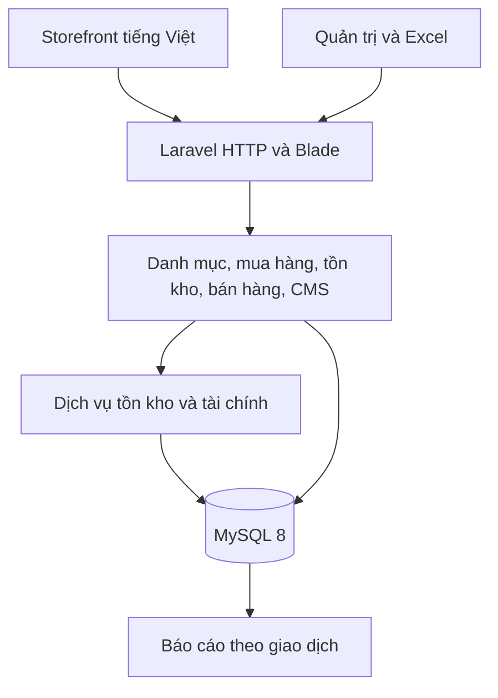

# Kiến trúc KITLAB

Prompt phù hợp với mô hình modular monolith. Giữ giao dịch mua, kho và bán trong cùng một database để khóa tồn và ghi sổ trong một transaction. Tách tồn khả dụng, giá vốn và dòng tiền thành các dữ liệu riêng. Nhà cung cấp thanh toán cần hợp đồng tích hợp và thông tin sandbox của merchant.

## ERD theo miền

Schema thực thi và các ràng buộc chi tiết nằm ở database/schema.sql. Mũi tên thể hiện khóa ngoại theo miền.

```mermaid
erDiagram
    ROLES ||--o{ ROLE_USER : assigns
    USERS ||--o{ ROLE_USER : holds
    PERMISSIONS ||--o{ PERMISSION_ROLE : grants
    ROLES ||--o{ PERMISSION_ROLE : contains
    USERS ||--o{ AUDIT_LOGS : writes
    CATEGORIES ||--o{ PRODUCTS : groups
    BRANDS ||--o{ PRODUCTS : brands
    PRODUCTS ||--o{ PRODUCT_VARIANTS : has
    PRODUCTS ||--o{ PRODUCT_IMAGES : shows
    PRODUCT_VARIANTS ||--o{ PRODUCT_BARCODES : identifies
    PRODUCT_VARIANTS ||--o{ PRODUCT_SUPPLIER : sourced
    SUPPLIERS ||--o{ PRODUCT_SUPPLIER : offers
    SUPPLIERS ||--o{ PURCHASE_ORDERS : supplies
    PURCHASE_ORDERS ||--o{ PURCHASE_ORDER_ITEMS : contains
    PRODUCT_VARIANTS ||--o{ PURCHASE_ORDER_ITEMS : bought
    PURCHASE_ORDERS ||--o{ SHIPMENTS : tracks
    SHIPMENTS ||--o{ SHIPMENT_DOCUMENTS : contains
    SHIPMENTS ||--o{ IMPORT_EXPENSES : incurs
    PURCHASE_ORDERS ||--o{ GOODS_RECEIPTS : receives
    WAREHOUSES ||--o{ GOODS_RECEIPTS : receives
    GOODS_RECEIPTS ||--o{ GOODS_RECEIPT_ITEMS : contains
    PURCHASE_ORDER_ITEMS ||--o{ GOODS_RECEIPT_ITEMS : reconciles
    IMPORT_EXPENSES ||--o{ IMPORT_EXPENSE_ALLOCATIONS : distributes
    GOODS_RECEIPT_ITEMS ||--o{ IMPORT_EXPENSE_ALLOCATIONS : absorbs
    WAREHOUSES ||--o{ INVENTORY : stocks
    PRODUCT_VARIANTS ||--o{ INVENTORY : stocked
    INVENTORY ||--o{ INVENTORY_BATCHES : values
    INVENTORY ||--o{ INVENTORY_TRANSACTIONS : records
    INVENTORY ||--o{ STOCK_RESERVATIONS : reserves
    WAREHOUSES ||--o{ WAREHOUSE_LOCATIONS : contains
    USERS ||--o{ ORDERS : places
    ORDERS ||--o{ ORDER_ITEMS : contains
    PRODUCT_VARIANTS ||--o{ ORDER_ITEMS : sold
    ORDER_ITEMS ||--o{ STOCK_RESERVATIONS : requires
    ORDER_ITEMS ||--o{ FULFILLMENTS : ships
    FULFILLMENTS ||--o{ COST_ALLOCATIONS : values
    INVENTORY_BATCHES ||--o{ COST_ALLOCATIONS : supplies
    ORDERS ||--o{ ORDER_STATUS_HISTORIES : tracks
    ORDERS ||--o{ PAYMENTS : collects
    FULFILLMENTS ||--o{ RETURN_ITEMS : reverses
    ORDERS ||--o{ REFUNDS : refunds
    EXPENSE_CATEGORIES ||--o{ OPERATING_EXPENSES : groups
    USERS ||--o{ FINANCIAL_TRANSACTIONS : records
    BLOG_CATEGORIES ||--o{ BLOG_POSTS : groups
    USERS ||--o{ BLOG_POSTS : authors
    USERS ||--o{ IMPORT_JOBS : uploads
    IMPORT_JOBS ||--o{ IMPORT_JOB_ERRORS : rejects
```

## Quyền theo vai trò

| Vai trò | Quyền ghi | Quyền đọc |
|---|---|---|
| Super Admin | Toàn bộ | Toàn bộ |
| Administrator | Người dùng và cấu hình | Toàn bộ |
| Product Manager | Danh mục, SKU, Excel sản phẩm | Danh mục |
| Purchasing Manager | Nhà cung cấp, PO, lô nhập | Mua hàng |
| Inventory Manager | GRN, điều chỉnh và chuyển kho | Kho và PO |
| Order Manager | Xử lý đơn, xuất hàng, trả hàng | Đơn và kho |
| Accountant | Chi phí, đối soát, hoàn tiền | Tài chính, mua hàng, kho, đơn |
| Content Editor | Blog và SEO | CMS |
| Customer Support | Ghi chú hỗ trợ | Đơn hàng |
| Khách hàng | Giỏ và đơn của chính mình | Danh mục và đơn của chính mình |

## Quy trình và công thức

- PO chụp tỷ giá khi tạo. Duyệt rồi đặt hàng trước khi nhận. GRN khóa dòng PO, ghi hàng đạt/hỏng/thiếu, chặn nhập vượt PO và tạo lớp giá mới cho số lượng đạt. Mỗi khoản chi được quy đổi bằng tỷ giá riêng. Chia chi phí theo số lượng, giá trị, trọng lượng hoặc số tiền phân bổ thủ công. Thuế được khấu trừ được lưu riêng. Khoản đã ghi sổ cần bút toán điều chỉnh nếu thay đổi.
- Số lượng khả dụng = tồn thực tế − số lượng giữ chỗ. Khóa dòng tồn trước khi giữ chỗ, xuất, chuyển hoặc điều chỉnh. Khi hủy, trả giữ chỗ. Khi giao từng phần, ghi giá vốn của phần giao và giảm giữ chỗ. Khi trả hàng đạt kiểm định, nhập lại theo giá vốn của lần xuất gốc.
- FIFO dùng các lớp tồn cũ nhất trong kho. WAC di động = giá trị tồn WAC / số lượng tồn trước lần xuất. Giá vốn chụp theo cả hai phương pháp. Quy tròn VND ở cấp giao dịch, phân bổ phần dư cho đơn vị cuối cùng. Giá trị lưu theo DECIMAL với độ chính xác theo từng nghiệp vụ.
- Doanh thu hàng thuần = giá bán ghi nhận − giảm giá − hoàn doanh thu. Lợi nhuận gộp = doanh thu thuần − COGS. Lợi nhuận hoạt động = lợi nhuận gộp − chi phí hoạt động. Lợi nhuận ròng = lợi nhuận hoạt động + thu nhập khác − chi phí khác. Tỷ suất chia cho doanh thu thuần, trả trống nếu mẫu số bằng 0. Cước thu khách theo dõi riêng, phí vận chuyển/COD/thanh toán ghi chi phí hoạt động, VAT được khấu trừ theo dõi riêng. Thu chi thực tế báo cáo theo ngày đối soát. Báo cáo quản trị theo chứng từ cần đối chiếu trước khi dùng cho kế toán pháp định.
- Catalog/CMS phục vụ danh mục, tìm kiếm, sản phẩm, bài viết và sitemap. Excel dùng phiên nhập có bước xem trước và xác nhận. Báo cáo đọc dữ liệu đã ghi sổ, lọc kỳ và phương pháp giá vốn.

## Lộ trình

1. Schema, tài khoản, phân quyền, layout.
2. Catalog, SKU/biến thể, barcode và Excel.
3. Nhà cung cấp, PO, nhập từng phần, landed cost.
4. Tồn đa kho, sổ kho, FIFO và WAC.
5. Storefront, giỏ, checkout và thực hiện đơn.
6. Giá vốn, hoàn trả, chi phí, đối soát.
7. Blog, metadata, sitemap, tích hợp analytics.
8. Dashboard và xuất báo cáo.
9. Kiểm thử MySQL, kiểm thử tải và chạy UAT trước triển khai.
